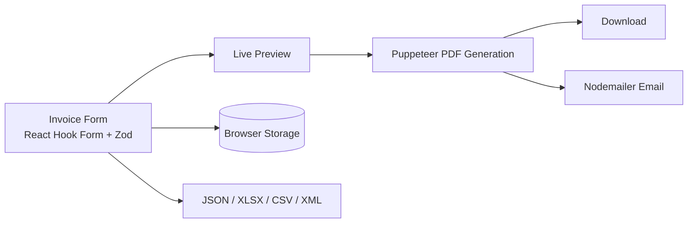

<div align="center">

# SPC Invoice

**A web-based invoice generator for creating, previewing, exporting and emailing professional invoices.**


[](LICENSE.txt)

[Live Demo](https://inv-spc-source.vercel.app/) · [Features](#features) · [Getting Started](#getting-started) · [Roadmap](#roadmap) · [Author](#author)


</div>

---

## Table of Contents

- [Overview](#overview)
- [Demo](#demo)
- [Features](#features)
- [Technologies](#technologies)
- [How It Works](#how-it-works)
- [Getting Started](#getting-started)
  - [Prerequisites](#prerequisites)
  - [Installation](#installation)
  - [Environment Variables](#environment-variables)
  - [Available Scripts](#available-scripts)
- [Export Formats](#export-formats)
- [Troubleshooting](#troubleshooting)
- [Roadmap](#roadmap)
- [Contributing](#contributing)
- [License](#license)
- [Acknowledgements](#acknowledgements)
- [Author](#author)

---

## Overview

SPC Invoice is a web-based invoice generator built with Next.js, TypeScript, React and the shadcn/ui component library. It provides a fast way to create and manage professional invoices: fill in a form, watch the invoice update in a live preview, then download it as a PDF or send it by email.

---

## Demo

Try the live version: **[inv-spc-source.vercel.app](https://inv-spc-source.vercel.app/)**

---

## Features

- **Simple invoice creation:** Generate an invoice from a single, structured form.
- **Live preview:** Edit the form and see changes reflected instantly.
- **Multiple templates:** Choose between two invoice templates.
- **Save and retrieve:** Invoices are stored in the browser and can be reloaded from a saved list.
- **PDF download and email:** Download the invoice as a PDF or send it directly to a recipient.
- **Multiple export formats:** Export as JSON, XLSX, CSV or XML.
- **Validated input:** Form data is validated with a typed schema before generation.

---

## Technologies

### Core

| Technology       | Purpose                                      |
|------------------|----------------------------------------------|
| Next.js          | React framework for SSR and routing          |
| TypeScript       | Static typing                                |
| shadcn/ui        | Accessible, customizable UI components       |
| Tailwind CSS     | Utility-first styling                        |
| React Hook Form  | Form state and input management              |
| Zod              | TypeScript-first schema validation           |
| Puppeteer        | PDF generation with a headless browser       |

### Additional

| Technology   | Purpose                                  |
|--------------|------------------------------------------|
| Nodemailer   | Sending invoices by email                |
| Lucide Icons | Customizable SVG icon set                |

---

## How It Works



1. The user fills in the invoice form, which is validated with Zod.
2. The selected template renders a live preview as the form changes.
3. The invoice can be saved to the browser for later use.
4. On download or email, Puppeteer renders the invoice to PDF on the server.
5. The PDF is returned to the user or sent as an attachment through Nodemailer.

---

## Getting Started

### Prerequisites

- Node.js 18 or later
- npm

### Installation

1. Clone the repository:

   ```bash
   git clone https://github.com/ItsTalhaIqbal/inv.spc-source.git
   cd inv.spc-source
   ```

2. Install dependencies:

   ```bash
   npm install
   ```

3. Create a `.env.local` file (required only for the email feature):

   ```env
   NODEMAILER_EMAIL=your_email@example.com
   NODEMAILER_PW=your_email_password
   ```

4. Start the development server:

   ```bash
   npm run dev
   ```

5. Open [http://localhost:3000](http://localhost:3000) in your browser.

### Environment Variables

| Variable           | Required | Description                                  |
|--------------------|----------|----------------------------------------------|
| `NODEMAILER_EMAIL` | Optional | Sender email address used to send invoices   |
| `NODEMAILER_PW`    | Optional | Password or app password for the sender      |

> **Security:** Never commit `.env.local`. For Gmail and similar providers, use an app-specific password instead of your account password.

### Available Scripts

| Command         | Description                          |
|-----------------|--------------------------------------|
| `npm run dev`   | Start the development server         |
| `npm run build` | Create a production build            |
| `npm run start` | Run the production build             |
| `npm run lint`  | Run the linter                       |

---

## Export Formats

| Format | Use Case                                       |
|--------|------------------------------------------------|
| PDF    | Sharing and printing                           |
| JSON   | Backup and re-importing invoice data           |
| XLSX   | Spreadsheet editing                            |
| CSV    | Accounting tools and data import               |
| XML    | Integration with external systems              |

---

## Troubleshooting

| Problem                       | Likely Cause                                  | Resolution                                                |
|-------------------------------|-----------------------------------------------|-----------------------------------------------------------|
| Email is not sent             | Missing or incorrect credentials              | Check `.env.local` and use an app password if required    |
| PDF generation fails          | Puppeteer cannot launch the browser           | Reinstall dependencies and verify Chromium is available   |
| Saved invoices are missing    | Browser storage was cleared or a different browser is used | Invoices are stored per browser; export as JSON for backup |
| Environment changes not applied | Server not restarted                        | Restart `npm run dev` after editing `.env.local`          |

---

## Roadmap

- [x] Create invoices with a simple form
- [x] Save invoices in the browser
- [x] Retrieve invoices from a saved list
- [x] Download as PDF or send by email
- [x] Multiple invoice templates (currently 2)
- [x] Live preview
- [x] Export as JSON, XLSX, CSV and XML
- [ ] Internationalization (i18n) for the UI and templates
- [ ] Themeable templates with selectable accent color
- [ ] Custom inputs, for example a VAT number
- [ ] Individual tax for line items

---

## Contributing

Contributions, issues and feature requests are welcome.

1. Fork the repository
2. Create a feature branch (`git checkout -b feat/your-feature`)
3. Commit using [Conventional Commits](https://www.conventionalcommits.org) (`git commit -m "feat: add your feature"`)
4. Push the branch (`git push origin feat/your-feature`)
5. Open a Pull Request

---

## License

Distributed under the MIT License. See [LICENSE.txt](LICENSE.txt) for more information.

---

## Acknowledgements

SPC Invoice is based on the open-source project [Invoify](https://github.com/al1abb/invoify), released under the MIT License.

---

## Author

**Talha Iqbal**
A developer

[](https://github.com/ItsTalhaIqbal)
[](https://linkedin.com/in/itstalha-iqbal)
[](https://talha-iqbal.vercel.app)

<div align="center">

If you find this project useful, consider giving the repository a star.

</div>
